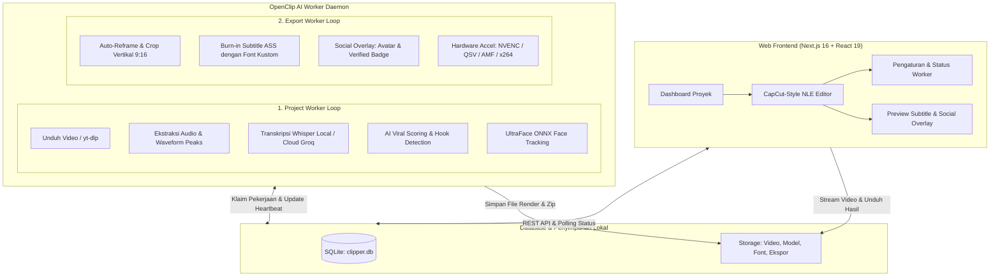

# 🎬 OpenClip — AI Video Clipper & Pro NLE Editor

OpenClip adalah platform open-source pemotong dan pengubah video panjang menjadi video pendek vertikal (Shorts, TikTok, Reels) bertenaga AI. Dilengkapi deteksi momen viral otomatis, transkripsi ucapan per-kata (karaoke), pelacakan wajah cerdas (*face tracking*), *social media badge overlay*, dan dashboard editor NLE (*Non-Linear Editor*) bertema CapCut Dark Pro.

Semua data tersimpan secara lokal (Single-File SQLite), bebas biaya langganan cloud, dan dapat dijalankan 100% offline dengan mesin heuristik audio bawaan.

---

## 🏛️ Arsitektur Sistem

OpenClip memisahkan antara frontend interaktif, basis data lokal, dan worker pemrosesan video berkemampuan konkurensi ganda (*dual concurrent worker*):



---

## ✨ Fitur-Fitur Utama

### 1. 🤖 Analisis Viralitas AI (Multi-LLM & Heuristik Offline)
- **Multi-Provider Cloud LLM**: Mendukung Anthropic Claude (3.5/3.7/4.5 Sonnet), OpenAI (GPT-4o, GPT-4o-mini), Groq, dan Google Gemini (2.0/2.5 Flash).
- **Fallback Heuristik Cerdas (100% Offline & Gratis)**: Jika tidak memiliki API key, sistem secara otomatis mengevaluasi ritme bicara, kepadatan kata, kata kunci pemicu rasa ingin tahu (*hook triggers*), serta lonjakan dinamika energi audio WAV mono 16kHz.
- **Sentence Boundary Snapping**: Klip tidak pernah terpotong di tengah pengucapan kata atau kalimat yang menggantung.
- **Parameter Penilaian Transparan**: Setiap klip dilengkapi skor 0–100 pada 5 indikator: *Hook*, *Emotion*, *Standalone Value*, *Punchline*, dan *Pacing*.

### 2. 🎙️ Transkripsi Presisi Tinggi (Word-Level Timestamping)
- **faster-whisper (Lokal)**: Berjalan di CPU atau GPU CUDA offline dengan opsi model `tiny`, `base`, `small`, `medium`, hingga `large-v3`.
- **Cloud STT Super Cepat**: Mendukung Groq Cloud (`whisper-large-v3`) dan OpenAI Audio Transcription API dengan *chunking* audio otomatis di bawah 25 MB.
- **Sinkronisasi Kata Presisi**: Setiap kata memiliki informasi *timestamp start* dan *end* hingga satuan milidetik untuk animasi karaoke.

### 3. 🎯 Pelacakan Wajah Otomatis (Smart Auto-Reframe 9:16)
- **UltraFace ONNX Runtime**: Mendeteksi koordinat wajah pembicara utama secara *real-time* per segmen.
- **Dynamic Pan & Smooth Camera**: Menggeser jendela potong vertikal secara halus mengikuti pergerakan subjek tanpa guncangan visual mendadak.

### 4. 🎨 Dashboard Editor CapCut Pro (`/projects/[id]`)
- **Estetika CapCut Dark Pro**: Palet warna profesional (Dark `#12131a`, Laser Cyan `#4cd7f6`, Mint `#4edea3`, Amber `#ffb95f`).
- **NLE Multi-Track Timeline**:
  - **Track T1**: Blok teks subtitle interaktif (geser batas, edit transkripsi langsung).
  - **Track V1**: Pemangkasan (*trimming*) titik In & Out klip video.
  - **Track A1**: Visualisasi grafik waveform audio asli 25 fps.
  - Jarum Playhead laser presisi dengan kemampuan scrubbing mulus.
- **Live Subtitle Karaoke Real-time**:
  - Efek kata aktif bersinar (*active word glow*), animasi pop/bounce, bayangan tebal, dan kotak latar teks (*boxed style*).
  - 8 Font lokal bawaan: *Montserrat*, *Poppins*, *Anton*, *Bebas Neue*, *Bangers*, *Archivo Black*, *Luckiest Guy*, dan *Inter*.
- **Social Media Branding Overlay**:
  - Avatar lingkaran sempurna tanpa border berlebih.
  - Lencana verifikasi asli (*authentic verified rosette badge*) khas Instagram/TikTok/Twitter.
  - Kustomisasi nama tampilan (*display name*) dan handle sosial (@username).
- **Safe Zone Guides**: Garis panduan *Title Safe 90%* dan *Action Safe 80%* agar konten tidak tertutup elemen antarmuka TikTok/Reels.
- **Autosave & History**: Penyimpanan otomatis ke SQLite dengan *debounce* 600ms serta riwayat Undo (`Ctrl+Z`) & Redo (`Ctrl+Y`).

### 5. ⚡ Mesin Ekspor Paralel (Dual Concurrent Worker)
- **Ekspor Tanpa Antrean Terblokir**: Antrean download/transkripsi dan antrean ekspor video FFmpeg berjalan di *thread* terpisah. Rendering ekspor tetap berjalan instan meskipun worker sedang mengunduh video baru.
- **Akselerasi Perangkat Keras**: Deteksi otomatis NVIDIA NVENC (`h264_nvenc`), Intel QuickSync (`h264_qsv`), AMD AMF (`h264_amf`), atau *software encoder* berkualitas tinggi (`libx264`).
- **Ekspor Satuan & Paket ZIP**: Unduh klip perorangan atau gunakan fitur **Export All & Download ZIP** dalam satu klik.

---

## 🚀 Panduan Menjalankan (1-Klik Multiplatform: Windows & macOS / MacBook)

OpenClip kini dilengkapi **Unified 1-Click Launcher** cerdas untuk **Windows** dan **macOS / MacBook (Apple Silicon M1/M2/M3/M4 & Intel)** serta Linux.

> **Sistem Otomatis (Zero-Config):**
> Saat pertama kali dijalankan, sistem otomatis mendeteksi apakah `uv`, `Python`, dan dependensi sudah terpasang. Jika belum, launcher akan **mengunduh dan memasang `uv` serta Python 3.12 mandiri secara otomatis** tanpa perlu hak akses administrator maupun konfigurasi manual!

---

### A. Pengguna Windows: Cukup Jalankan `start.bat`

Cukup klik ganda file:
```text
start.bat
```
Atau jalankan melalui command prompt:
```cmd
start.bat
```

**Apa yang terjadi saat `start.bat` dijalankan?**
1. **Deteksi Otomatis:** Memeriksa ketersediaan Node.js, `uv`, Python, dan dependensi.
2. **Auto-Install jika Belum Ada:**
   - Memasang `uv` secara otomatis via PowerShell jika belum ada.
   - Mengunduh dan memasang Python 3.12 mandiri via `uv python install 3.12` jika Python belum ada.
   - Menjalankan `npm install` untuk frontend Next.js dan `uv sync` untuk AI Worker.
   - Mengunduh 8 font TTF lokal dan menginisialisasi database SQLite.
3. **Langsung Menyalakan Aplikasi:**
   - Jendela 1: Web Server Next.js (`http://localhost:3000`)
   - Jendela 2: OpenClip AI Worker Daemon (Project & Export paralel)
   - Browser default Anda akan otomatis terbuka ke `http://localhost:3000`.

*(Jika Anda hanya ingin memasang dependensi tanpa menyalakan server: `start.bat install`).*

---

### B. Pengguna macOS / MacBook (Apple Silicon & Intel) & Linux

**Opsi 1: 1-Klik Langsung dari Finder (Paling Praktis)**
Cukup klik ganda file berikut di Finder macOS:
```text
start.command
```
*(Terminal bawaan Mac akan terbuka secara otomatis dan menyalakan OpenClip).*

**Opsi 2: Lewat Terminal (macOS & Linux)**
Buka aplikasi **Terminal**, arahkan ke folder OpenClip, lalu jalankan salah satu:
```bash
./start.command
```
*(Atau ketik `bash start.bat` — file `start.bat` kini sudah berformat polyglot dual-OS yang otomatis mendeteksi macOS/Linux).*

**Fitur Launcher macOS & Linux (`start.command`):**
1. **Dukungan Penuh Apple Silicon (M1/M2/M3/M4) & Intel**: Otomatis mendeteksi arsitektur Mac (`arm64` / `x86_64`).
2. **Auto-Install `uv` & Python 3.12**: Jika Mac Anda belum memiliki Python atau `uv`, script akan memasangnya secara otomatis.
3. **Auto-Install Node.js**: Terintegrasi dengan Homebrew jika Node.js belum terpasang.
4. **Paralel Background Engine & Auto-Browser**: Web Server dan AI Worker langsung menyala di latar belakang, dan browser otomatis terbuka dengan perintah bawaan macOS (`open http://localhost:3000`).
5. **Clean Exit**: Cukup tekan `Ctrl+C` di terminal untuk mematikan Web Server dan AI Worker secara bersih.

*(Jika hanya ingin memasang dependensi di Mac/Linux tanpa menyalakan server: `./start.command install`).*

---

## 🔑 Panduan Konfigurasi Kunci API (Opsional)

OpenClip **dapat berjalan tanpa API key apapun** menggunakan model lokal Whisper dan Heuristik Offline. Namun, jika Anda ingin menggunakan model AI cloud, Anda dapat memasukkan kunci API melalui salah satu dari dua cara berikut:

### Metode A: Lewat Web UI (Paling Praktis)
1. Buka OpenClip di browser: [http://localhost:3000/settings](http://localhost:3000/settings).
2. Masukkan API Key pada kolom penyedia yang Anda miliki:
   - **Groq API Key**: [Daftar Gratis di Groq Console](https://console.groq.com/keys) *(Sangat cepat & gratis untuk Whisper Large v3)*.
   - **Google Gemini API Key**: [Dapatkan di Google AI Studio](https://aistudio.google.com/app/apikey) *(Tersedia kuota gratis)*.
   - **OpenAI API Key**: [Platform OpenAI](https://platform.openai.com/api-keys).
   - **Anthropic API Key**: [Anthropic Console](https://console.anthropic.com/).
3. Klik tombol **Uji Kunci** untuk memvalidasi, lalu klik **Simpan Pengaturan**.

### Metode B: Lewat File `worker/.env`
Buka file `worker/.env` menggunakan editor teks, lalu isi kunci Anda:
```env
GROQ_API_KEY=gsk_...
GEMINI_API_KEY=AIzaSy...
OPENAI_API_KEY=sk-...
ANTHROPIC_API_KEY=sk-ant-...
```

---

## 🛠️ Perintah Tambahan (Unified Launcher)

Satu file `start.bat` (Windows) dan `start.command` (macOS/Linux) dapat menerima perintah sub-komponen berikut:
- **`start.bat web [port]`** / **`./start.command web [port]`**: Menjalankan Web Server saja (port bawaan: 3000).
- **`start.bat worker`** / **`./start.command worker`**: Menjalankan AI Worker ganda (transkripsi + ekspor).
- **`start.bat export`** / **`./start.command export`**: Menjalankan Dedicated Export Worker khusus render antrean ekspor.
- **`start.bat install`** / **`./start.command install`**: Menjalankan pemeriksaan dan instalasi seluruh dependensi saja.
- **`start.bat check`** / **`./start.command check`**: Menjalankan pemeriksaan diagnostik sistem (database, FFmpeg, font, API keys).

---

## ⌨️ Pintasan Keyboard Editor (NLE)

| Tombol Pintasan | Fungsi |
|---|---|
| `Spasi` | Play / Pause pemutaran video |
| `←` (Panah Kiri) | Mundur 1 frame |
| `→` (Panah Kanan) | Maju 1 frame |
| `Ctrl + Z` | Undo perubahan teks / gaya / crop |
| `Ctrl + Y` | Redo perubahan yang dibatalkan |
| `L` | Mengaktifkan / mematikan perulangan (loop) klip |
| `Esc` | Menutup jendela modal yang sedang aktif |

---

## 🔧 Panduan Troubleshooting & FAQ

### 1. `better-sqlite3` gagal saat kompilasi di Windows
- **Penyebab**: Versi Node.js yang sangat baru belum memiliki prebuild binary yang cocok.
- **Solusi**: OpenClip telah diperbarui ke `better-sqlite3@12.11.1` yang mendukung Node.js v18 hingga v24 secara native tanpa perlu Visual Studio C++ compiler. Jika terjadi kendala, buka folder `web` di terminal dan jalankan:
  ```cmd
  cd web
  npm rebuild better-sqlite3
  ```

### 2. Unduhan YouTube Gagal atau Muncul Pesan *Bot Detection*
- **Penyebab**: Algoritma YouTube berubah atau versi `yt-dlp` lawas.
- **Solusi**: Perbarui `yt-dlp` ke rilis terbaru:
  ```cmd
  cd worker
  uv pip install --upgrade yt-dlp
  ```
  *(atau jika memakai venv: `.venv\Scripts\pip install --upgrade yt-dlp`)*

### 3. Port 3000 Sedang Digunakan oleh Aplikasi Lain
- **Penjelasan**: Next.js akan secara otomatis mendeteksi konflik port dan beralih ke port berikutnya (misalnya `http://localhost:3001`). Periksa baris log pada jendela CMD Web Server.

### 4. Font Subtitle Tidak Muncul di Hasil Render
- **Solusi**: Pastikan font TTF telah terunduh ke direktori `web/public/fonts`. Anda dapat mengunduh ulang kapan saja dengan perintah:
  ```cmd
  cd worker
  uv run python scripts/download_fonts.py
  ```

### 5. Ingin Menggunakan GPU untuk Transkripsi Lokal
- **Solusi**: Pastikan driver NVIDIA dan CUDA Toolkit terpasang, kemudian pasang pustaka cuBLAS / cuDNN untuk ctranslate2:
  ```cmd
  cd worker
  uv pip install nvidia-cublas-cu12 nvidia-cudnn-cu12
  ```

---

## 📁 Struktur Direktori Repositori

```text
openclip/
├── database/                 # Skema & file database SQLite (clipper.db)
├── storage/                  # Penyimpanan lokal: video, audio, ekspor, & model
├── web/                      # Frontend Next.js 16 + React 19 + Tailwind CSS
│   ├── public/fonts/         # Font lokal TTF untuk subtitle ASS & preview
│   └── src/
│       ├── app/              # App Router: Pages & REST API Routes
│       ├── components/       # Komponen UI: NLE Timeline, Canvas, Inspector
│       └── lib/              # Database helper & utilitas caption
├── worker/                   # Python AI Worker Daemon
│   ├── clipper/              # Engine: Whisper STT, Analyzer, Face Tracker, FFmpeg
│   ├── scripts/              # Helper script: download_fonts.py
│   ├── main.py               # Entrypoint worker loop & startup check
│   └── pyproject.toml        # Standar dependensi modern Python (uv / pip)
├── start.bat                 # Master Unified Launcher Windows (1-Klik untuk segalanya)
├── start.command             # Master Unified Launcher macOS & Linux (1-Klik Finder Mac / Terminal)
└── README.md                 # Dokumentasi utama proyek
```

---

## 📄 Lisensi

OpenClip dirilis di bawah lisensi open-source MIT. Bebas digunakan, dimodifikasi, dan didistribusikan untuk keperluan pribadi maupun komersial.
